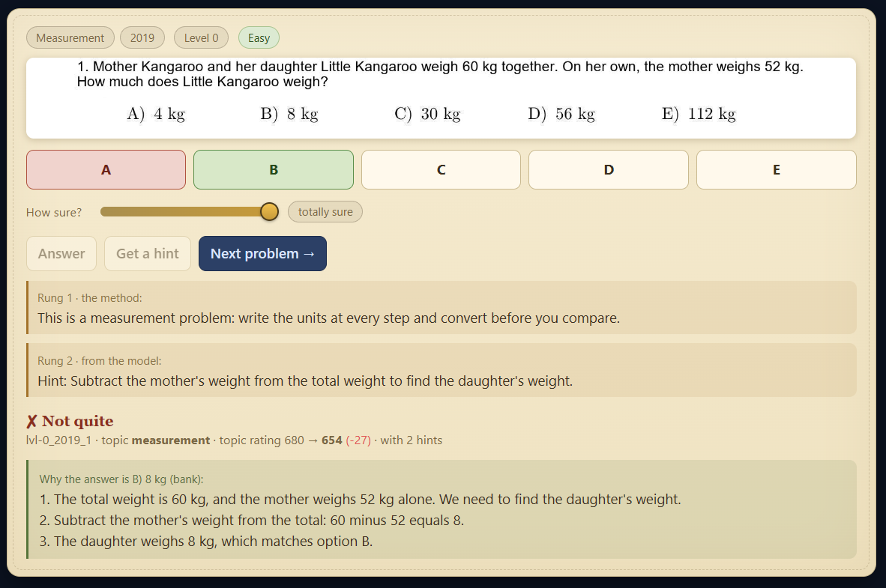

# Math on the Edge: a Math Copilot on the Arduino UNO Q

Datathon FME 2026 - Qualcomm challenge. A math copilot that runs entirely
on the Arduino UNO Q (4 GB, offline) and uses M3Kang (1,747 Kangaroo Math
problems, 108 languages) to both **reason** and **teach**.

The team: Konrad Danielewicz, Alex Pons, Marc Cabrero, Andrei Vasilev.

Acces to the interface: http://10.198.33.209:8001/

## What the copilot does

**Reason** (measured by the jury on a hidden test): `predict.py` answers
each problem with one letter, A-E, in under 60 s. A cascade router decides
per problem: exact Python solvers first, then a nearest-neighbour vote over
solved M3Kang problems (trusted only on near-duplicates), the
median-of-values rule for numeric options, a letter prior per difficulty
level, and the LLM as last resort with D as fallback. Details, ablations and
test-day operations: `METODO_FINAL.md`.

**Teach** (the Kangaroo Trainer, port 8001): adaptive practice per topic
with an Elo rating per topic and per problem, a 3-rung hint ladder that
ends in the answer only on purpose, and a step-by-step explanation after a
wrong answer - generated offline with a 4B model, validated in code, and
served from the board instantly.

## The board services

| Service | Port | What it is |
| --- | --- | --- |
| `math-trainer` | 8001 | The Trainer web app (this repo, `trainer/`) |
| `math-llm` | 8081 | llama.cpp + Qwen3.5-0.8B (letter answers, hints, explanations) |
| `math-embed` | 8082 | llama.cpp + bge-small (384-dim embeddings for retrieval) |

All three are systemd units (survive reboots, restart on failure).

## How M3Kang is used

- **Retrieval knowledge base**: every solved problem is embedded (bge-small)
  into a SQLite index; near-duplicate problems drive the router vote, the
  hint neighbours and the explanation anchors. Problems share their id
  across languages, so retrieval works in every language through the
  English twin.
- **Label priors per level and topic**, and the dataset that revealed the
  median-of-values distractor pattern.
- **The curriculum** for the Trainer's adaptive selection and Elo rating.
- **The source of the explanation bank** (see below).

## The solution bank: step-by-step explanations, offline

The 0.8B model on the board cannot write a correct worked solution - the
base measurements show it barely picks the right letter (22.5% bare). So
the explanations are **not generated at runtime**. They are generated once,
on a laptop, with a bigger model, validated, and served from a file:

1. `laptop/build_solutions.py` prompts **Qwen3.5-4B** (local GGUF) with the
   problem, its five options, the correct option's value and the topic's
   method, and asks for exactly 3 numbered steps that *check* the correct
   option rather than derive it (verifying backwards is what a small model
   can do; deriving from scratch is not).
2. Every candidate is **validated in code** (`trainer.hints.consistent()`):
   the text must land on the correct option's value in its final sentence
   and never name a different letter as correct. One retry at temperature 0,
   then the entry is marked `rejected` and never served. Entries whose text
   hedges ("Wait, let me recalculate...") are demoted too.
3. The result is `data/solutions.jsonl`: one JSON line per problem
   (`id`, `language`, `label`, `text`, `status`). Resumable and crash-safe
   (appended line by line, flushed as it goes).
4. At startup the trainer loads the `ok` entries into memory (~1,050
   explanations, levels 0-6, English and Catalan). When a student fails a
   problem, the explanation is served from the bank in **0 ms, 0 tokens** -
   nothing leaves the device, and the demo never waits for a small model to
   improvise mathematics.

The explanation chain at runtime (`trainer/hints.py: explain_answer()`):

1. **Bank** - instant, validated offline.
2. **0.8B verify-backwards** - for problems without a bank entry: same 3-step
   scaffold with the options and the correct value in the prompt, validated
   with the same `consistent()`, one cold retry.
3. **Deterministic fallback** - the worked neighbour from the retrieval
   index plus the topic's method cue. Always right, never brilliant.

No path can show a wrong explanation: every generated text is checked, and
the last resort is deterministic.

## The hint ladder

Three rungs, deterministic first, model second, answer last:

1. **The method** - the topic's strategy cue, written by hand, no model.
2. **A first-step hint from the model** - a 0.8B given only the bare
   problem writes generic advice that fits any problem, so the prompt is
   grounded: it carries the problem plus its worked solution (from the bank
   when there is one, else the similar solved problem from retrieval), with
   the landing sentence removed so the answer is not in front of it. The
   model only compresses the first step into one sentence (<= 35 words, in
   the problem's language). The leak check rejects any hint that names an
   option value or the correct letter; one colder retry, then rung 1.
3. **The reveal** - the correct letter with its value, only on purpose.

Each hint used scales the attempt score by 0.85, so the shortcut is paid
for in Elo.

## The Trainer, in short

- **Login gate**: every student picks (or creates) a sailor name; progress,
  Elo and history are per sailor, remembered per browser (`/api/users`).
- **Practice view**: the problem image, letters-only options, a certainty
  slider (feeds the Elo score), the hint ladder, and the post-answer
  explanation with a chronometer pinned to the side.
- **Statistics tab**: general Elo sparkline, accuracy tiles, rating bars per
  topic, accuracy by level, a topic x level heatmap, and the full attempt
  history (answer vs correct, time, hints, Elo delta).
- **Adaptive selection**: 75% softmax over the gap to the user's average
  rating + 25% uniform; difficulty follows the topic rating; problems are
  seeded from level and difficulty and drift with the Elo of the people
  who attempt them.

## Replicating on a board after steps 0-12

1. Clone this repo and `git pull` (code).
2. Copy the gitignored data into `data/` (M3Kang is research-only):
   `solutions.jsonl`, `tags.json`, `train.jsonl`, `val.jsonl`, `index.db`,
   `images/`.
3. Rebuild the retrieval index: `python3 build_index.py --only-with-options`.
4. Check the services: `systemctl status math-llm math-embed math-trainer`.
5. Tag the problems: `python3 -m trainer.build_tags --embed-url
   http://127.0.0.1:8082`.
6. Open port 8001 and practice. Verify explanations with
   `laptop/board_check.py` (expects `source: bank` on a bank problem).

To regenerate the bank on a laptop with a 4B GGUF:
`python laptop/build_solutions.py --limit 25` first, then without `--limit`.
`laptop/watch_solutions.py` shows entries while it runs;
`laptop/board_check.py` verifies the board serves them.

## Results and error analysis

- `results/ablations.csv`: every experiment against the baseline.
- `METODO_FINAL.md`: the two modes (jury vs uniform), the final prediction
  flow, and test-day operations.
- The error analysis by topic, language and difficulty lives in the team
  results section of the repo history and in `results/`.

## What didn't work

- An ensemble over strategies scored worse than the raw router (19.5% vs
  22.3%) - documented in the ablations.
- Serving explanations with the 0.8B at runtime: free-form derivation from a
  0.8B is wrong most of the time; the bank replaced it.
- The Qwen3.5-2B as the board LLM: ~2.4 GB on a 3.6 GB board swaps and
  wedges generation (and cannot coexist with the embedding server). The
  0.8B stays.
- Four parallel workers for bank generation: the 4B is memory-bandwidth
  bound; 2 workers with a 2-slot server was the throughput sweet spot.
- Thinking mode for bank generation: doubled the cost with no gain in the
  landing rate.
